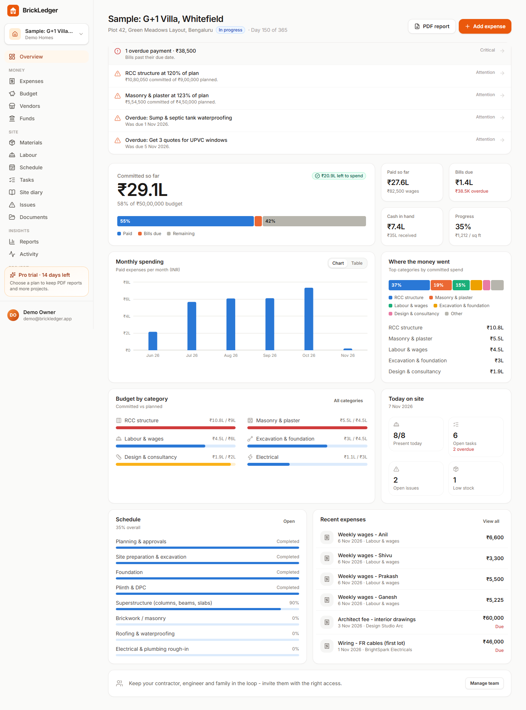
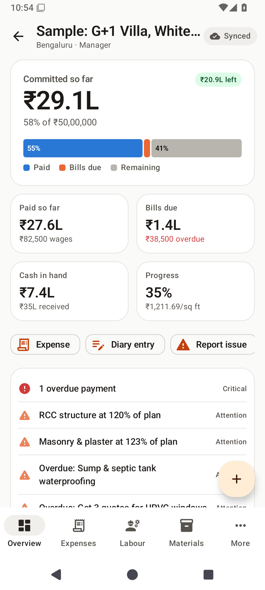
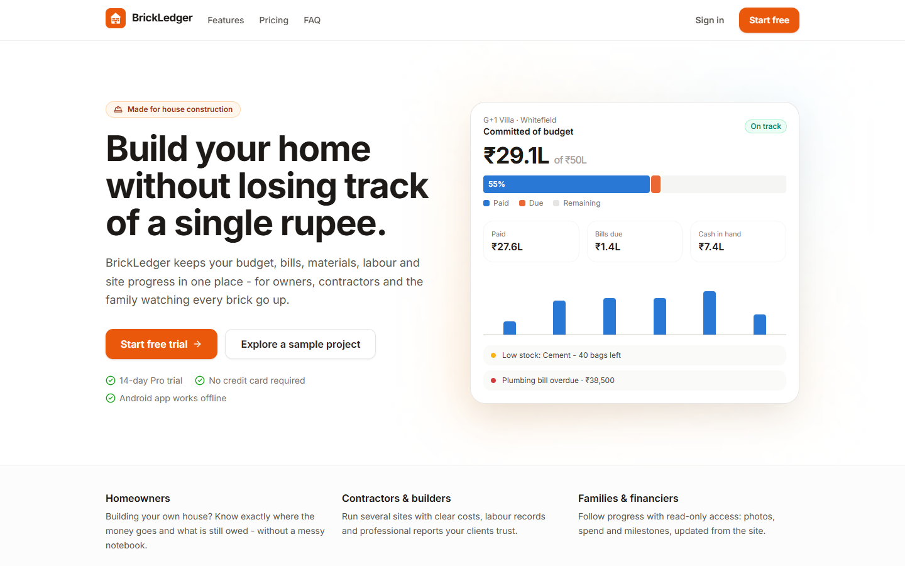
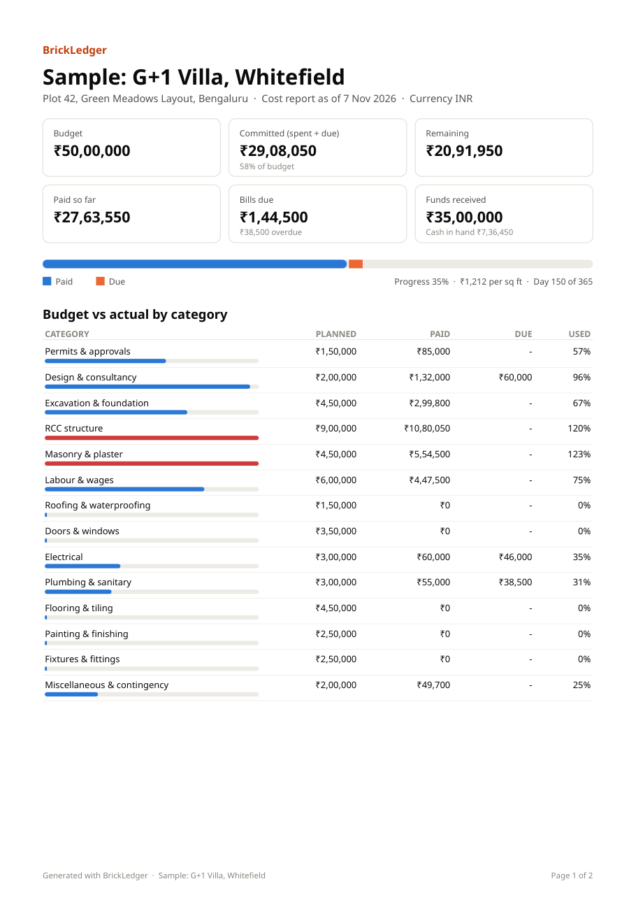
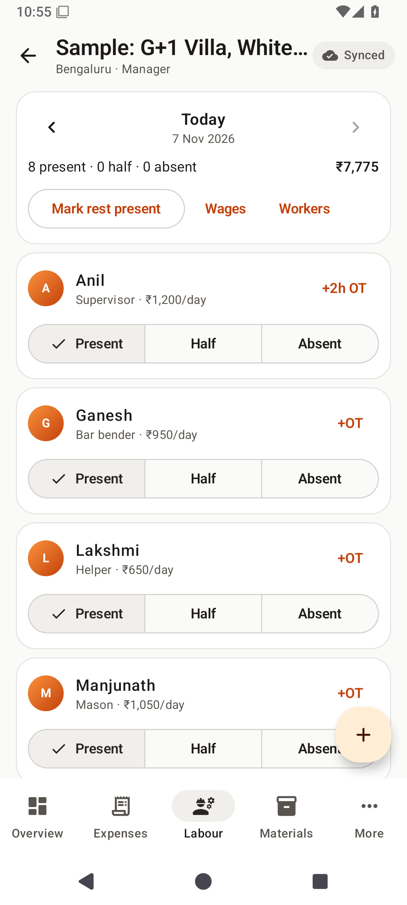

# BrickLedger

**Cost, material, labour and progress tracking for house construction** - a complete, sellable SaaS product:

| Part | Stack | Where |
|---|---|---|
| REST API + sync server | Node 22 · TypeScript · Fastify 5 · Drizzle ORM · PostgreSQL (PGlite for zero-install dev) | [`apps/api`](apps/api) |
| Web app (marketing site, pricing, full dashboard) | React 19 · Vite 8 · Tailwind CSS 4 · TanStack Query | [`apps/web`](apps/web) |
| Android app (offline-first) | Kotlin 2.2 · Jetpack Compose · Material 3 · Room · WorkManager · Retrofit | [`apps/android`](apps/android) |
| Shared domain model | Vocabularies, plans, templates, zod schemas, API types | [`packages/shared`](packages/shared) |

<p>


</p>

---

## What it tracks

Everything a house build needs, for owners, contractors and the family watching:

- **Budget vs actual**: total budget split across 14 standard construction heads (permits, design, foundation, RCC, masonry, labour, roofing, doors & windows, electrical, plumbing, flooring, painting, fixtures, contingency). Planned, paid, due and remaining per head, with over-budget alerts.
- **Expenses & bills**: amount, vendor, category, phase, payment mode (cash/UPI/bank/cheque/card), quantity × rate, GST, reference numbers, receipts (photo/PDF), *paid* vs *bill due* with due dates and overdue alerts.
- **Vendors & contractors**: contract amount, paid, due and **balance to pay**, call from the app, payment history.
- **Materials & stock**: deliveries and consumption, stock in hand, average rate, purchase value, procurement progress vs estimate, **low-stock alerts**. Receiving stock can create the matching expense in the same step.
- **Labour**: workers and trades, **one-tap daily attendance** (present / half day / absent + overtime), earned wages, payments, advances and balances.
- **Schedule**: 14 phases from approvals to handover with planned and actual dates, progress and late flags (Gantt view on web).
- **Tasks**: Kanban board (web) and checklist (Android) with priorities, assignees and due dates.
- **Site diary**: daily work done, weather, labour count, problems and photos.
- **Issues & snags**: defects with severity, owner, fix-by date and photos.
- **Funds**: savings, home-loan tranches, family support or client payments, giving **cash in hand** vs bills due.
- **Documents & photos**: drawings, permits, agreements and warranties with **expiry reminders**.
- **Reports**: professional 2-page **PDF cost report**, 11 **CSV exports**, monthly spending, cost per sq ft.
- **Team & audit trail**: invite by email or shareable link (WhatsApp-friendly) as *Manager*, *Contributor* or *Viewer*. Every change is logged with who and when.

## What makes it sellable

- **Multi-tenant SaaS**: workspaces → projects → members with roles; workspace owners/admins manage everything; clients/family get read-only access.
- **Subscription plans** (configurable in [`packages/shared/src/plans.ts`](packages/shared/src/plans.ts)): *Starter* (free, 1 project), *Pro* and *Business*, with a **14-day Pro trial**, server-enforced limits (projects, people, storage) and feature gates (PDF reports, white-label reports).
- **Payments**: pluggable billing with **Stripe** (global) and **Razorpay** (India: UPI, cards, netbanking) - hosted checkout, signature-verified idempotent webhooks, cancel/portal. A `mock` provider upgrades instantly for demos.
- **Marketing site**: landing page, pricing with monthly/yearly toggle, FAQ, terms & privacy templates.
- **Onboarding**: "Explore a sample project" builds a realistic, fully-populated villa build in one click (doesn't count against plan limits).
- **Offline Android app** with background sync, daily reminders and photo capture - the feature site users care about most. It also works **with no account and no internet at all** (see [Offline mode](#offline-mode-no-account-no-internet)). Visitors can download it directly from the website's `/download` page, with install steps and a QR code.
- **Multi-currency** (20 currencies, lakh/crore formatting for INR) and light/dark themes.

<p>



</p>

---

## Quick start (local development)

Requirements: **Node 22.12+**. No database install needed - the API uses an embedded PostgreSQL (PGlite) until you set `DATABASE_URL`.

```bash
npm install
npm run seed:demo        # demo login: demo@brickledger.app / demo12345 (with a sample project)
npm run dev              # API on http://localhost:4000, web on http://localhost:5173
```

Open http://localhost:5173. Emails (password reset, invites) are printed to the API log until you configure SMTP; upgrades use the `mock` billing provider.

Useful scripts (from the repo root):

| Command | What it does |
|---|---|
| `npm test` | 46 API integration tests (auth & token rotation, permissions, plan limits, sync, billing webhooks, uploads, PDF/CSV, admin panel, analytics) |
| `npm run typecheck` | TypeScript checks for every workspace |
| `npm run build` | Production build: web (`apps/web/dist`) + bundled API (`apps/api/dist`) |
| `npm start` | Run the built API (`SERVE_WEB=true` also serves the web app) |
| `npm run db:generate` | Generate a SQL migration after editing [`schema.ts`](apps/api/src/db/schema.ts) |

### Android

Open [`apps/android`](apps/android) in Android Studio (or use the Gradle wrapper; JDK 17+, Android SDK 36):

```bash
cd apps/android
./gradlew installDebug                                   # emulator → talks to http://10.0.2.2:4000
./gradlew installDebug -Pbrickledger.apiUrl=http://192.168.1.20:4000/   # a phone on your Wi-Fi
./gradlew assembleStaging                                # release-minified QA build, debug-signed
./gradlew bundleRelease                                  # Play Store bundle (see "Release signing")
```

The server address can also be changed on the sign-in screen (server icon). Release builds only allow HTTPS. To try the app without any server, tap **Use offline on this phone** on the sign-in screen.

---

## Architecture

```
 Android (Room = source of truth)          Web (TanStack Query cache)
   │  push changes (client UUIDs)              │  REST + httpOnly refresh cookie
   │  pull changes since cursor                │
   ▼                                           ▼
 ┌──────────────────────── Fastify API (/api/v1) ────────────────────────┐
 │ auth (JWT 15 min + rotating refresh tokens, reuse detection)          │
 │ access control (workspace role → project role)  · plan limits        │
 │ resources (generic CRUD + soft delete + activity log)  · sync         │
 │ analytics (SQL aggregates) · PDF (PDFKit) · CSV · files (local/S3)    │
 │ billing (Stripe / Razorpay / mock)                                    │
 └──────────────────────────────┬────────────────────────────────────────┘
                                ▼
                     PostgreSQL (Drizzle migrations)
```

**Offline sync.** Every write to a project table takes a value from a global sequence (`server_seq`). The Android app writes to Room first (instant UI), marks rows dirty, and a WorkManager job (needs network) pushes them as idempotent mutations keyed by client-generated UUIDs. It then pulls everything with `server_seq > cursor`, including soft-deleted tombstones. Edits made while a push is in flight are protected by a local revision counter. Two phones marking the same worker on the same day are merged by the server. Photos are compressed on the phone and uploaded once their parent record exists on the server. Details: [`docs/API.md`](docs/API.md#offline-sync-used-by-the-android-app).

**Optimisations.** Dashboard and report numbers are computed with SQL aggregates on both sides (Postgres on the server, SQLite on the phone). The web app is code-split per page (entry bundle ~80 KB gzipped, pages 1-4 KB; zod stays out of the browser). The release APK is **2.4 MB** (R8 + resource shrinking) and loads images through an authenticated, disk-cached client. Responses are gzip-compressed, and file URLs are signed and cacheable for an hour.

**Local database upgrades.** The Room schema is versioned and exported to [`app/schemas`](apps/android/app/schemas) (version 2 added phone-only projects through an automatic migration). There is no destructive fallback, so every future schema change needs a migration - an upgrade must never drop unsynced or phone-only data.

**Security.** scrypt password hashing, short-lived JWTs, rotating refresh tokens with family revocation on reuse, httpOnly SameSite cookies on web, Keystore-encrypted tokens on Android, strict CSP/HSTS via Helmet, rate-limited auth, zod validation on every input, upload type allow-list (no SVG/HTML), sandboxed file responses, CSV formula-injection guarding, and server-side role checks on every route (contributors can only delete their own entries).

---

## Admin panel

Super admins get a panel at `/admin` (in the account menu once signed in) covering the whole system:

| Section | What it does |
|---|---|
| **Overview** | Accounts, active users, downloads, visitors, estimated monthly revenue, plans, and everything people have recorded |
| **Accounts** | Search and filter accounts, see their workspaces, projects and signed-in devices. Ban or unban with a reason, sign out everywhere, create a password reset link, edit name or email, delete, export CSV |
| **Workspaces** | Search by name or owner, see usage and storage, give a plan for free, extend a trial |
| **Website** | Pages opened, visitors, time on site, top pages, referrers, countries and devices (7, 30 or 90 days) |
| **Android app** | Downloads by day, source and version; active installs and versions in use |
| **Audit log** | Every action taken in the panel: who, what, on whom, when, and why |
| **System** | Database, storage, email and payments status, with what still needs setting up |

**Becoming a super admin.** This is a flag in the database that only the command line can set. Nothing on the website can grant it, and sign-ups don't verify email ownership, so an "admin email" setting could be claimed by whoever registers that address first.

```bash
# Sign up on the site first, then (uses DATABASE_URL, or the one in a git-ignored .env.vercel):
npm run admin -- grant you@example.com
npm run admin -- list
npm run admin -- revoke you@example.com
```

**Safeguards.** Non-admins get a plain 404, and the flag is re-read on every admin request. Super admins can't be banned or deleted from the panel, and you can't act on yourself. A ban takes effect within 30 seconds on every server instance, even for tokens already issued. Deleting requires typing the account's email. The panel shows project names and counts, not project contents.

**Analytics.** Self-hosted and anonymous: no cookies and no stored IP addresses, just daily totals in `analytics_counters`. A visitor is counted once a day using a hash that includes the date and a server secret, and is deleted after a few days. Browsers with Global Privacy Control or Do Not Track aren't counted, nor are known bots or the admin panel. Because the hash changes daily, the panel adds up daily visitors rather than claiming monthly uniques. App downloads are counted when they go through `/api/v1/public/download/android` (the download page and in-app updates do); the app reports a random install id and its version, which aren't linked to any account. Days follow `STATS_TIMEZONE` (default `Asia/Kolkata`).

## Offline mode (no account, no internet)

The Android app doesn't need the server to be useful. Its Room database holds every project on the phone, and the dashboard, budget, labour and stock numbers are computed on the device, so the server is only needed for accounts, sharing with a team and the web app.

| Situation | What happens |
|---|---|
| No account | **Use offline on this phone** on the sign-in screen. Projects are created on the phone (with the same budget heads, phases and materials templates) and stay there. |
| Signed in, no internet | Existing projects keep working and sync when the connection returns. A new project is saved on the phone and marked **On this phone**. |
| Session expires or is revoked | The app asks you to sign in again; nothing on the phone is deleted, and unsynced changes are pushed after sign-in. If a *different* person signs in, the previous user's cached cloud projects are removed (phone-only projects stay). |

- **Reports on the phone**: for phone-only projects, the PDF cost report and the CSV exports are generated on the device.
- **Backups**: a project's More tab → **Back up to a file** writes a zip (`backup.json` plus the photos stored on the phone) to share to Google Drive, WhatsApp or email. On the other phone, tap the file and choose **Open with → BrickLedger** (or **Share → BrickLedger**). A confirmation shows the project and what it contains, then it's added as a new phone-only project - no account needed, even on a phone that has never been set up. The file can also be picked from the sign-in screen (**Restore a backup from another phone**), an empty project list or Settings. Every id is regenerated, so a restored copy never collides with the original. Restored entries are queued for upload, so **Move to the cloud** sends all of them. Damaged, half-downloaded or foreign files are rejected with a specific message before anything is changed.
- **Move to the cloud**: after signing in, More → **Move to the cloud** creates the project on the server, re-keys every local row to the server's id and uploads the entries and photos through the normal sync. The app then opens the cloud project.

Why not run the API and PostgreSQL on the phone itself? That would add a Node runtime and a second database to the app (tens of MB, battery drain, Android's background limits) and still couldn't share data with family, the contractor or the web app. The phone already has the database and the logic; offline mode removes the need for an account.

## Configuration

All server settings are environment variables; every one is documented in [`apps/api/.env.example`](apps/api/.env.example). For production you must set:

| Variable | Why |
|---|---|
| `JWT_SECRET` | 32+ random characters (`openssl rand -base64 48`) |
| `DATABASE_URL` | PostgreSQL connection string (Neon, Supabase, RDS, Cloud SQL, or the bundled compose file) |
| `APP_URL`, `CORS_ORIGINS` | Your public web address (used in emails, invite links, payment redirects) |
| `SMTP_URL`, `MAIL_FROM` | Transactional email (password resets, invitations) |
| `STORAGE_DRIVER=s3` + `S3_*` | Photos/documents on S3, Cloudflare R2 or MinIO (container disks are ephemeral) |
| `BILLING_PROVIDER` + keys | `stripe` or `razorpay` (see below) |

**Stripe:** create Pro/Business × monthly/yearly recurring prices, put their IDs in `STRIPE_PRICE_*`, and add a webhook to `https://<domain>/api/v1/billing/webhooks/stripe` for `checkout.session.completed`, `customer.subscription.*` and `invoice.payment_failed`.
**Razorpay:** create four subscription plans (`RAZORPAY_PLAN_*`) and a webhook to `https://<domain>/api/v1/billing/webhooks/razorpay` for `subscription.*` events.
Displayed prices live in [`plans.ts`](packages/shared/src/plans.ts) (INR and USD); set `PRICING_CURRENCY`.

## Deployment

### Vercel (website + API in one project)

The repo is ready to import into Vercel as is. [`vercel.json`](vercel.json) runs [`scripts/vercel-build.mjs`](scripts/vercel-build.mjs), which uses Vercel's Build Output API to publish the web app as static files and the API as one Node.js function at `/api`. Both share one domain, so no CORS or cross-site cookie setup is needed.

1. **Database:** create a PostgreSQL database (e.g. [Neon](https://neon.tech); choose a region near your users) and copy its **pooled** connection string.
2. **File storage:** create an S3-compatible bucket (e.g. Cloudflare R2). The function's disk is read-only, so without it uploads are refused with a clear message.
3. **Import:** Vercel → *Add New Project* → pick this repo. Keep the root directory and leave the build settings alone; `vercel.json` supplies them.
4. **Environment variables** (Production):

| Variable | Value |
|---|---|
| `DATABASE_URL` | the Neon connection string |
| `JWT_SECRET` | 48+ random characters |
| `STORAGE_DRIVER=s3`, `S3_BUCKET`, `S3_ENDPOINT`, `S3_ACCESS_KEY_ID`, `S3_SECRET_ACCESS_KEY` (`S3_REGION=auto` for R2) | your bucket |
| `SMTP_URL`, `MAIL_FROM` | email provider (until then, emails go to the function logs) |
| `APP_URL` | only once you add a custom domain, e.g. `https://yourdomain.com` (defaults to the project's production domain) |
| `FUNCTION_REGION` | optional: run the API next to the database, e.g. `bom1` (Mumbai) for Neon `ap-south-1` |
| `BILLING_PROVIDER` + keys | `mock` until Razorpay/Stripe is set up |

5. **Deploy** (or redeploy after adding variables). Migrations run during **production** builds (`MIGRATE_ON_BUILD=true` also runs them for previews; avoid that if previews share the production database). Check `https://<your-project>.vercel.app/api/health`: it should say `"db":"pg"` and `"storage":"s3"`. Until `DATABASE_URL` and `JWT_SECRET` are set, the API answers with a `SETUP_REQUIRED` message saying what's missing.

Differences from a long-running server: uploads are capped at 4 MB (Vercel's request limit is 4.5 MB; photos from the Android app are compressed well below that), rate limits are counted per function instance, and the first request after a quiet period takes a little longer (cold start). To build exactly what Vercel deploys: `node scripts/vercel-build.mjs` → `.vercel/output`.

### Docker (single container + PostgreSQL)

```bash
JWT_SECRET=$(openssl rand -base64 48) POSTGRES_PASSWORD=$(openssl rand -hex 16) \
APP_URL=https://app.yourdomain.com docker compose up -d --build
```

The image builds the web app and serves it from the API with SPA routing, long-lived caching for hashed assets and a health check at `/api/health`. Migrations run on start. Put it behind any TLS reverse proxy (Caddy, Nginx, a cloud load balancer).

### Any Node host

Render, Railway, Fly.io or a VM: `npm ci && npm run build`, then run `node apps/api/dist/index.js` from `apps/api` with `SERVE_WEB=true` and the variables above. Or host `apps/web/dist` on a CDN and point `/api` at the server.

### Android release

**Signing:** create a keystore once, then add `apps/android/keystore.properties`. Both files are git-ignored:

```bash
cd apps/android
keytool -genkeypair -keystore release.jks -storetype PKCS12 -alias brickledger -keyalg RSA -keysize 3072 -validity 10000
```

```properties
storeFile=release.jks
storePassword=...
keyAlias=brickledger
keyPassword=...
```

**Back up `release.jks` and `keystore.properties` somewhere safe** (e.g. a password manager). Android only installs an update over an app signed with the same key, so losing them means every user has to uninstall and reinstall.

Set your live address once in [`apps/android/gradle.properties`](apps/android/gradle.properties), e.g. `brickledger.productionUrl=https://your-project.vercel.app`. Release builds use it for the API, the web links and the invite deep-link host.

**Publish a new version** (website `/download` page + in-app update prompt):

```bash
npm run release:android -- --notes "Fixed sign-up"     # 1.0.1 -> 1.0.2; also --minor, --major, --no-bump
git add apps/web/public/apk apps/android/gradle.properties && git commit -m "Android 1.0.2" && git push
```

The script raises the version in [`apps/android/gradle.properties`](apps/android/gradle.properties), builds the signed APK and writes it to `apps/web/public/apk/` with `android.json` (version, size, checksum, notes) and the QR code.

**In-app updates:** the app reads `<server>/apk/android.json` when it opens and every few hours. If `versionCode` is higher than its own, it shows "Update available" with the notes. "Update now" downloads with progress, verifies the SHA-256 and opens Android's installer; "Later" asks again after a day (or as soon as a newer version appears), and Settings → App version always offers it. Checks fail silently when offline. Android rejects any update not signed with the same key.

**Google Play:** `./gradlew bundleRelease`, then upload the `.aab` in Play Console. Google Play forbids apps updating themselves, so before uploading remove the `REQUEST_INSTALL_PACKAGES` permission from `AndroidManifest.xml` and the `UpdateDialog` call in `AppNavHost.kt`; Play then delivers updates.

## Going to market - checklist

- [ ] **Brand:** the name lives in `APP_NAME` ([`constants.ts`](packages/shared/src/constants.ts)), `app_name` ([`strings.xml`](apps/android/app/src/main/res/values/strings.xml)), the logo SVG/vector drawables and `applicationId` (`com.brickledger.app`). Check trademark availability before launch.
- [ ] **Legal:** the Terms and Privacy pages are templates - have them reviewed for your jurisdiction (e.g. India's DPDP Act, GDPR).
- [ ] **Pricing:** adjust plans/limits in `plans.ts` and create the matching Stripe/Razorpay prices.
- [ ] **Play Store:** privacy policy URL, Data safety form (account info, photos, financial info you enter; encrypted in transit; deletion available), account-deletion link (`/app/settings` → Delete account), screenshots from `docs/screenshots`. Subscriptions are sold on the web; the app links to it.
- [ ] **Operations:** managed Postgres with daily backups, S3/R2 bucket, SMTP provider, error monitoring, uptime check on `/api/health`.

## Project structure

```
apps/
  api/        Fastify server: src/modules/{auth,account,admin,tracking,orgs,billing,projects,resources,sync,files,members,analytics,reports}
              src/db/schema.ts (Drizzle) · drizzle/ (SQL migrations) · test/ (Vitest + in-memory PGlite)
  web/        React app: src/pages/{marketing,auth,app,project,admin} · src/components (UI kit, charts, forms)
  android/    Compose app: data/ (Room, Retrofit, sync engine, workers, backups, on-device reports) · ui/ (theme, components, screens)
packages/
  shared/     Vocabularies, plans, templates, zod schemas, API types, formatting
docs/         API reference, screenshots
```

## Known limitations / next steps

- Phone-only projects exist only on that phone until they're backed up or moved to the cloud; there are no automatic backups yet (a scheduled export to Google Drive would be the next step). They also can't be shared with other people until moved to the cloud.
- Backups of *cloud* projects include every entry but only the photos still on the phone (photos already uploaded stay on the server).
- Wage history is calculated with each worker's *current* daily wage.
- Conflict resolution is last-write-wins per record; field-level merging isn't implemented.
- Not yet built: push notifications (FCM), in-app billing on Android (plans are bought on the web), Hindi/regional-language UI, and an iOS app.
